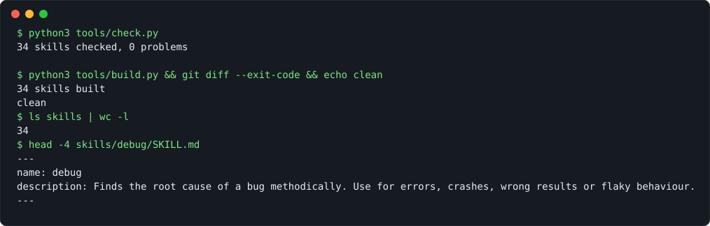

# engineering-skills

34 ready-made skills (Agent Skills `SKILL.md` files) that tell an AI coding assistant, including small local models, how to plan, build, test, debug, review, ship and operate software, step by step.



The picture is real output from a clean clone. Here is one whole skill, `skills/debug/SKILL.md`:

```markdown
---
name: debug
description: Finds the root cause of a bug methodically. Use for errors, crashes, wrong results or flaky behaviour.
---

## Steps
1. Reproduce the bug with the smallest input. Run `pytest tests/test_bug.py` or the exact failing command in isolation.
2. Read the full error and stack trace. Record the exception type, file path, and line number.
3. Form one hypothesis. Test it using logs, a debugger, or `git bisect`. Do not guess.
4. Find the root cause, not the symptom. Verify the failing condition matches your hypothesis.
5. Write a failing test that captures the exact failure. Run it to confirm it fails.
6. Apply the fix. Run the full test suite. Show the new test passing and existing tests green.
7. Scan related code paths. Note what else the cause may affect and log follow-up tasks.

## Checklist
- [ ] Reproduction is minimal and deterministic
- [ ] Full stack trace and error context are captured
- [ ] Single hypothesis tested with evidence
- [ ] Root cause identified, not a symptom workaround
- [ ] Failing test written and confirmed to fail before the fix
- [ ] Fix applied and all tests pass
- [ ] Related code paths reviewed for side effects

## Output
- Minimal reproduction command or test case
- Root cause explanation with file and line reference
- Failing test code and the applied fix
- List of affected code paths or follow-up tasks
```

## Quick start

Claude Code (project skills; use `~/.claude/skills/` instead to install for all projects):

```bash
git clone https://github.com/YauhenBichel/engineering-skills
mkdir -p my-project/.claude/skills
cp -r engineering-skills/skills/* my-project/.claude/skills/
```

Each skill is then a folder `my-project/.claude/skills/<name>/SKILL.md`, which is the layout Claude Code reads. The copy gives 34 folders.

Check that the skills are well formed (needs Python 3, no packages):

```bash
cd engineering-skills
python3 tools/check.py
```

Expected output: `34 skills checked, 0 problems`

Other agents that read Agent Skills: copy the same folders to the skills folder that agent documents. Any chat: paste one `SKILL.md` before your question.

## When to use it

- You want your assistant to follow a checkable method (steps, a checklist, a defined output) for a common job, such as `debug`, `write-tests`, `review-code` or `write-adr`.
- You run a local model that loses the thread on long, vague prompts.

## When not to use it

- You need skills for one language framework or one company's rules. These are general.
- You need proof that skills improve answers. That is not measured yet (see Limits).

## FAQ

### What are Agent Skills?

A skill is a folder with a `SKILL.md` file. Its front matter has a `name` and a `description`, and the body tells the model what to do. Tools that support the format load a skill when the task matches its description. The format is described at [agentskills.io](https://agentskills.io).

### How do I install skills in Claude Code?

Copy the skill folders into `.claude/skills/` in your project, or into `~/.claude/skills/` for all projects, as shown above.

### Does it send my data anywhere?

No. The repository is Markdown files and small Python scripts. Only `tools/draft.py` calls a model server, and only the one you configure.

### How is it different from other skill collections?

These are short (about 250 words each), checked by a script in CI, and were written and corrected by hand after a local model drafted them. They were made for local models; they work with any model.

### Which skills are there?

See the table below and `SKILLS.md`, which gives one line on when to use each.

## What is in it

| Area | Skills |
|---|---|
| Plan | `clarify-requirements`, `break-down-work`, `estimate-and-risks` |
| Design | `design-architecture`, `write-adr`, `design-api`, `model-data` |
| Build | `implement-feature`, `write-python`, `write-go`, `write-typescript`, `write-sql`, `write-cli`, `concurrency`, `algorithms` |
| Quality | `write-tests`, `debug`, `review-code`, `refactor`, `performance`, `security-review`, `handle-errors-and-logging` |
| Ship | `git-workflow`, `ci-cd`, `containers-and-deploy`, `dependencies` |
| Operate | `observability`, `incident-response`, `data-durability` |
| Communicate | `write-docs`, `explain-code` |
| Data | `data-analysis`, `ml-experiment` |
| Research | `research-and-compare` |

`SKILLS.md` lists every skill with one line on when to use it.

Each `skills/<name>/SKILL.md` has front matter (`name`, `description`) and three sections:

- **Steps**: what to do, in order, with real commands.
- **Checklist**: what to check before saying the work is done.
- **Output**: what the answer must contain.

Each skill is under about 300 words. Local models follow short, direct steps better than long essays. The
skills work with any model.

## Use them

- **Continue (VS Code):** `python3 tools/build.py --install` writes each skill as a slash command
  (`~/.continue/prompts/skill-<name>.md`) and a rule that lists them (`~/.continue/rules/05-skills.md`).
  Then type `/debug`, `/write-tests`, ... in the chat.
- **[yserver-vscode](https://github.com/YauhenBichel/yserver-vscode):** set `yserver.skillsDirs` to this
  repository's `skills` folder, then run a skill on the selected code with Cmd+Alt+S.
- **Claude Code and other Agent Skills tools:** copy or link a skill folder into their skills folder.
- **Any chat:** paste a `SKILL.md` as the system prompt, or in front of your question.

## Guessing the skill from a message

`tools/examples.jsonl` has 244 example messages (6 for each skill, plus 40 that need no skill), and
`tools/examples-test.jsonl` has 142 more, written separately, for testing. A program can pick a skill
for a message by finding the nearest examples (embeddings), with the "none" examples competing.

`python3 tools/measure_guess.py` measures it. With bge-m3 embeddings and the default limits (k 2,
threshold 0.55, margin 0.06): of the 102 test messages that need a skill, 30 got the right skill, 1 got
a wrong one, and 71 got none; none of the 40 messages that need no skill got one. Matching the skill
descriptions instead was wrong more often than right. All examples were written by a model, so real
messages may score lower.

## How they were made

1. `tools/catalogue.json` lists each skill: area, name, description and the points it must cover.
2. `tools/draft.py` drafted each skill with a local model (qwen3.6-coder 35B) through an OpenAI-compatible
   API: `OPENAI_BASE_URL` (default `http://localhost:8080/v1`), `OPENAI_MODEL`, `OPENAI_API_KEY`.
   `drafts.log` records the time each one took.
3. Every draft in `drafts/` was then read and corrected by hand. Typical fixes: limits the model made up
   ("files under 150 lines"), advice that was wrong (an `rsync --delete` mirror called a backup, automatic
   reruns that hide flaky tests), and project-specific paths that do not belong in a general skill.
4. `tools/build.py` turns `drafts/` plus the catalogue into `skills/` and `SKILLS.md`.

To change a skill, edit its file in `drafts/` and run `python3 tools/build.py`.

## Limits

- Written and checked by one person.
- Not yet measured: how much a skill improves answers. A test with and without the skills is planned.

## License

Apache-2.0. Part of [yserver](https://github.com/YauhenBichel/yserver-local-llm-system), a home LLM server.
